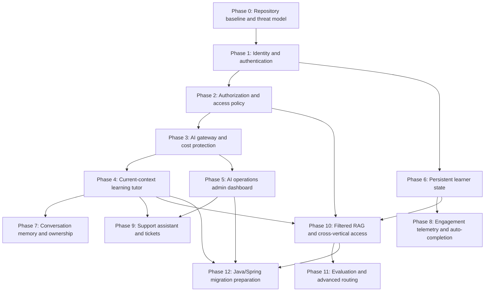

# NeuralAscent AI Learning Platform: Technical TODO Tracker

**Document type:** Implementation roadmap and engineering backlog  
**Target repository:** `balajiraghuram92/scaler-education-journey`  
**Current stack:** React/Vite frontend, ASP.NET Core API, PostgreSQL  
**Target evolution:** Secure multi-user learning platform, context-aware tutor, support assistant, AI operations dashboard, filtered RAG, and eventual Java/Spring AI backend  
**Status:** Proposed  
**Last updated:** 2026-09-01

---

## 1. Purpose

NeuralAscent is being expanded from a personal study tracker into a technically serious learning platform that demonstrates both Java backend fundamentals and production-oriented AI engineering. The implementation must not merely wrap an LLM API. It must demonstrate identity, authorization, tenant-safe data access, conversation ownership, cost controls, observability, progressive tutoring, support workflows, retrieval security, and controlled migration from ASP.NET Core to Java/Spring.

This tracker deliberately separates:

1. features required before a paid chatbot is exposed to multiple users;
2. features required for a useful current-context tutor;
3. features required for persistent learner personalization;
4. learning telemetry and automatic completion;
5. RAG and cross-vertical retrieval;
6. support-assistant workflows;
7. AI operations and administration;
8. eventual Java/Spring Boot migration.

The chatbot must be implemented incrementally. Authentication, quotas, and cost protection are launch prerequisites for public multi-user use. RAG, automatic completion, and the Java migration are not prerequisites for the first protected tutor.

---

## 2. Architectural principles

- [ ] **Exact context before retrieval:** Load the current course, lesson, exercise, MCQ, and learner state by authoritative IDs. Do not use vector search to guess records that the application already knows.
- [ ] **Authentication identifies the caller:** Resolve the user from a validated server-side principal. Never accept `userId`, roles, entitlements, or account status from the browser.
- [ ] **Authorization precedes data retrieval:** Verify access before loading restricted lesson content, conversation history, solutions, support records, or RAG chunks.
- [ ] **Conversation UUID is not authorization:** Every conversation lookup must include or validate the authenticated owner.
- [ ] **The LLM never grants access:** Java/.NET application code and SQL determine allowed verticals, lessons, hint levels, future concepts, and solution visibility.
- [ ] **Provider keys remain server-side:** No LLM key, shared secret, or privileged service credential may be included in Vite variables or browser JavaScript.
- [ ] **Cost is a controlled resource:** Enforce request, token, concurrency, and monetary budgets before invoking a paid provider.
- [ ] **Telemetry is processed before prompting:** Raw scroll events, clicks, and visibility changes remain application telemetry. Only compact pedagogically relevant summaries may enter the tutor prompt.
- [ ] **Tutor and support are distinct assistants:** They may share infrastructure but must have separate prompts, retrieval scopes, quotas, permissions, retention rules, and metrics.
- [ ] **Modular monolith first:** Keep the ASP.NET Core application modular. Introduce independent services only when scaling, security boundaries, or deployment needs justify them.
- [ ] **Provider-neutral AI interfaces:** The frontend API and domain contracts must survive migration from .NET to Spring Boot and changes between LLM providers.
- [ ] **No arbitrary model-controlled mutation:** Ticket creation, progress completion, user suspension, quota changes, and content publishing remain typed backend commands with authorization and validation.
- [ ] **Evaluate rather than assume:** Router, retrieval, tutoring, solution leakage, and support resolution require versioned evaluation datasets.

---

## 3. Delivery order and dependency map



### Launch gates

**Private owner-only prototype:** Phases 0, 3, and a reduced Phase 4 may be sufficient if the endpoint is inaccessible to the public.  
**Invite-only multi-user beta:** Phases 0 through 5, conversation ownership, and basic support ticket submission are required.  
**Public learning platform:** All security, quota, audit, support, privacy, and operational gates must pass before enabling unrestricted registration.

---

# Phase 0: Baseline, boundaries, and threat model

## P0.1 Inventory the current repository

- [ ] Document React routes, page components, API calls, environment-variable usage, and Nginx routing.
- [ ] Inventory ASP.NET Core endpoints currently defined in `Program.cs`.
- [ ] Inventory EF Core entities, migrations, seeds, and PostgreSQL constraints.
- [ ] Identify existing completion and task-toggle endpoints.
- [ ] Locate every use of the shared `x-api-key`.
- [ ] Confirm whether the production frontend exposes that shared key.
- [ ] Inventory content entities: vertical, course/pathway, chapter/module, lesson, exercise, MCQ, task, and project.
- [ ] Record which legacy entities remain authoritative during curriculum modernization.
- [ ] Identify data that must remain compatible during the later .NET-to-Java migration.

**Deliverable:** `docs/architecture/current-system-inventory.md`

## P0.2 Define trust boundaries

- [ ] Mark the browser as untrusted.
- [ ] Mark all IDs, editor code, page URLs, error text, and conversation IDs from the browser as untrusted inputs.
- [ ] Mark retrieved curriculum chunks as untrusted reference data for prompt-injection purposes.
- [ ] Treat PostgreSQL authorization and policy records as authoritative.
- [ ] Treat provider token counts as authoritative for final billing reconciliation when supplied.
- [ ] Treat estimated token counts only as admission-control approximations.

## P0.3 Threat model the paid AI path

Cover at least:

- [ ] copied browser request and direct API replay;
- [ ] stolen or exposed shared API key;
- [ ] automated registration and account farming;
- [ ] credential stuffing;
- [ ] conversation-ID enumeration;
- [ ] cross-user conversation access;
- [ ] vertical/lesson ID tampering;
- [ ] prompt injection from learner code;
- [ ] indirect prompt injection from indexed curriculum;
- [ ] expensive prompt amplification;
- [ ] concurrent-stream exhaustion;
- [ ] retry storms and duplicate billing;
- [ ] support-bot spam;
- [ ] retrieval of future exercises or official solutions;
- [ ] log leakage containing code, email, credentials, or prompts;
- [ ] broken admin authorization;
- [ ] model/provider outage;
- [ ] budget exhaustion.

**Definition of done**

- Threats are assigned severity and mitigation.
- Every paid-provider call has a documented admission path.
- No browser-held value alone can authorize a provider call.

---

# Phase 1: User identity, authentication, and session security

## P1.1 Introduce the user domain

- [ ] Add `app_user` with UUID public identifier, normalized email, display name, status, created/updated timestamps, and security metadata.
- [ ] Add roles initially: `LEARNER`, `SUPPORT_AGENT`, and `ADMIN`.
- [ ] Keep roles extensible for later `CONTENT_ADMIN`, `AI_OPERATIONS_ADMIN`, `USER_ADMIN`, and `SUPPORT_MANAGER` separation.
- [ ] Add account states: `PENDING`, `ACTIVE`, `SUSPENDED`, `LOCKED`, and `DELETED`.
- [ ] Ensure soft-deleted or suspended users cannot invoke the AI gateway.

## P1.2 Implement authentication

Recommended for the current browser application:

- [ ] Use ASP.NET Core Identity or a standards-compliant external identity provider.
- [ ] Prefer secure `HttpOnly` cookies for the browser flow.
- [ ] Set `Secure`, appropriate `SameSite`, bounded expiration, and session renewal policies.
- [ ] Add CSRF protection for cookie-authenticated state-changing endpoints.
- [ ] Add confirmed email for external users.
- [ ] Add password length, breached-password, lockout, and reset policies if local passwords are supported.
- [ ] Do not store access tokens in `localStorage` unless a deliberate SPA token architecture and XSS risk treatment are documented.

## P1.3 Control account creation

Initial deployment:

- [ ] Disable unrestricted registration.
- [ ] Create owner/admin account through a controlled bootstrap process.
- [ ] Add invitation-based registration or an email allowlist.
- [ ] Add invitation expiration, single use, issuer, and audit timestamps.

Public beta later:

- [ ] Add managed bot challenge.
- [ ] Rate-limit registration, login, reset, and verification endpoints.
- [ ] Add new-account low-trust quotas.
- [ ] Detect repeated account creation from the same network/device signals without relying on invasive fingerprinting.

## P1.4 Session lifecycle

- [ ] Record active sessions with user, issued time, last-seen time, expiry, revocation, and optional device label.
- [ ] Provide “sign out all sessions.”
- [ ] Revoke sessions after password reset, account suspension, or privilege change when policy requires it.
- [ ] Do not confuse authentication session with a chatbot conversation.

**Definition of done**

- Anonymous users cannot reach paid tutor endpoints.
- The server derives `userId` and roles from authentication.
- Suspended users receive a deterministic `403` response without an LLM call.
- Authentication integration tests cover login, logout, expiry, lockout, CSRF, and revoked sessions.

---

# Phase 2: Authorization, enrollment, and restricted content

## P2.1 Model content access

Add entities or equivalent policy records for:

- [ ] user-to-course enrollment;
- [ ] user-to-vertical entitlement;
- [ ] role-based administrative access;
- [ ] lesson publication and visibility;
- [ ] exercise and solution-disclosure policy;
- [ ] future-concept visibility;
- [ ] future-exercise restrictions;
- [ ] support-agent access to user-submitted material.

Suggested policy output:

```json
{
  "userId": "server-derived",
  "allowedVerticalIds": [1, 2],
  "allowedCourseIds": [11],
  "currentLessonAccessible": true,
  "maximumHintLevel": 2,
  "solutionAllowed": false,
  "futureConceptsAllowed": true,
  "futureExercisesAllowed": false
}
```

## P2.2 Enforce access before retrieval

- [ ] Validate that `exerciseId` belongs to `lessonId`.
- [ ] Validate that the lesson belongs to a course/vertical the caller can access.
- [ ] Reload authoritative curriculum content after the policy check.
- [ ] Apply policy filters inside SQL/vector queries, not only after retrieval.
- [ ] Never send inaccessible chunk titles or identifiers to the model.
- [ ] Never ask the model whether the user should be allowed access.

## P2.3 Cross-vertical tutor behavior

Example: a user in Java LLD asks about FDE content.

- [ ] Detect that the question requests another registered vertical.
- [ ] Query `AccessPolicyService` for that target vertical.
- [ ] If allowed, execute filtered cross-vertical retrieval.
- [ ] If denied, do not retrieve FDE chunks.
- [ ] Return an application-controlled response such as:

> Your account does not currently have access to the FDE pathway. I can explain the underlying idea using material available in your Java LLD pathway.

- [ ] Optionally provide a Java-only answer when pedagogically useful.
- [ ] Do not expose whether restricted lessons, exercises, or solutions exist beyond a generic access message.
- [ ] Record the denied cross-vertical attempt as a policy event, without treating a normal learner question as malicious.

## P2.4 Prevent horizontal and vertical privilege escalation

- [ ] Every conversation query validates owner or authorized support/admin role.
- [ ] Every ticket query validates creator, assignee, or admin scope.
- [ ] Every admin endpoint uses explicit policy names, not UI hiding.
- [ ] Add negative tests where user A supplies user B's conversation, lesson, ticket, or progress IDs.

**Definition of done**

- Unauthorized content is excluded before model invocation.
- Cross-vertical access tests cover allowed, denied, suspended, unpublished, and admin-only content.
- Model prompts never contain restricted evidence on denied requests.

---

# Phase 3: Shared AI gateway and financial safety controls

## P3.1 Create provider-neutral interfaces

- [ ] Define `IAiChatClient`, `IEmbeddingClient`, and optional `IRerankerClient`.
- [ ] Use internal request/response contracts independent of OpenAI-compatible provider JSON.
- [ ] Keep provider-specific streaming, usage, error mapping, and model parameters in adapters.
- [ ] Store provider credentials only in server configuration or a secret manager.
- [ ] Add provider timeout, cancellation, bounded retry, and circuit breaker.

## P3.2 Admission-control pipeline

Every paid invocation must pass:

```text
Authenticate
-> account status
-> authorize assistant and content
-> validate ownership
-> validate payload sizes
-> rate limits
-> concurrency limits
-> token estimate
-> per-user quota
-> global budget check
-> idempotency check
-> reserve usage
-> invoke provider
-> reconcile actual usage
```

- [ ] Centralize this pipeline so tutor, support, summarization, embeddings, reranking, and future agents cannot bypass it.
- [ ] Reject before provider invocation whenever possible.

## P3.3 Rate limiting

Implement layered policies:

- [ ] per authenticated user;
- [ ] per source IP;
- [ ] per conversation;
- [ ] per endpoint/assistant type;
- [ ] provider-wide/global;
- [ ] login and registration-specific limits.

Initial configurable defaults:

```yaml
ai:
  limits:
    per-user:
      messages-per-minute: 6
      messages-per-hour: 30
      messages-per-day: 100
      concurrent-streams: 2
    support:
      messages-per-hour: 15
      max-output-tokens: 800
    tutor:
      max-output-tokens: 1500
    global:
      concurrent-provider-calls: 20
```

Treat these as starting values to load-test and tune.

## P3.4 Token and monetary quotas

- [ ] Track input, cached input, output, reasoning, and total tokens when exposed by the provider.
- [ ] Estimate tokens before admission.
- [ ] Reserve estimated usage atomically to prevent concurrent quota overspend.
- [ ] Reconcile reservation to actual provider usage.
- [ ] Track provider/model pricing with effective dates.
- [ ] Never hardcode historical prices into invocation rows without the price version used.
- [ ] Track daily and monthly cost per user, assistant type, model, and operation.

## P3.5 Idempotency and duplicate-cost protection

- [ ] Require `clientRequestId` for message submission.
- [ ] Enforce a unique constraint scoped to conversation and request ID.
- [ ] Return the existing result for safe repeats.
- [ ] Do not automatically retry a non-idempotent stream after the provider may have accepted it.
- [ ] Prevent browser reconnection from creating a second completion.

## P3.6 Global budget guard

- [ ] Add hourly and daily cost ceilings.
- [ ] Add global input/output token ceilings.
- [ ] Add assistant-specific kill switches.
- [ ] Add expensive-model fallback enable/disable flag.
- [ ] Return deterministic service-limit responses without calling an LLM.
- [ ] Integrate provider-side budget alerts or hard limits where available.

## P3.7 Abuse and failure events

Record:

- [ ] rate-limit rejection;
- [ ] quota rejection;
- [ ] concurrency rejection;
- [ ] invalid/oversized payload;
- [ ] repeated ownership failure;
- [ ] provider timeout;
- [ ] provider rate limit;
- [ ] authentication failure;
- [ ] circuit-breaker open;
- [ ] global budget shutdown.

**Definition of done**

- No model call is possible without passing the shared gateway.
- Load tests prove per-user and global concurrency ceilings.
- A simulated retry storm does not produce duplicate provider calls for the same request.
- A simulated daily-budget breach disables further calls predictably.

---

# Phase 4: Current-context learning tutor

## P4.1 Frontend Knowledge Assistant

- [ ] Add a lesson/exercise-aware chat widget matching NeuralAscent's editorial UI.
- [ ] Display streaming state, cancellation, retry-safe errors, source indicators, and hint-level controls.
- [ ] Send IDs and unsaved editor context, never authoritative lesson text or permissions.
- [ ] Include current route, selected file, bounded selected code, compiler errors, failed tests, and current MCQ identifier when relevant.
- [ ] Add an explicit “Report an issue” handoff to support.
- [ ] Preserve accessibility: keyboard navigation, focus management, live-region streaming announcements, and reduced-motion behavior.

## P4.2 Trusted context resolver

Create `TutorContext` from:

- [ ] authenticated user;
- [ ] authorized vertical/course/chapter/lesson/exercise;
- [ ] canonical lesson and exercise content;
- [ ] current progress;
- [ ] unsaved editor state;
- [ ] prior hints;
- [ ] disclosure policy.

The browser may send unsaved code because the server cannot reload it, but it must be clearly labeled as untrusted learner data.

## P4.3 Progressive tutoring state

- [ ] Level 1: conceptual nudge or guiding question.
- [ ] Level 2: responsibility boundaries, interfaces, collaborators.
- [ ] Level 3: algorithm or pseudocode.
- [ ] Level 4: limited signature, method fragment, or partial implementation.
- [ ] Level 5: full solution only after explicit server policy permits.
- [ ] Persist highest hint level issued per exercise.
- [ ] Validate requested hint escalation against attempts and policy.
- [ ] Provide reflection after completion rather than more solution code.

## P4.4 Structured model output

Require a schema containing:

```json
{
  "answerType": "HINT",
  "hintLevel": 2,
  "diagnosis": "...",
  "messageMarkdown": "...",
  "nextAction": "...",
  "sourceChunkIds": [],
  "concepts": [],
  "solutionDisclosure": "PARTIAL",
  "confidence": "MEDIUM"
}
```

- [ ] Parse and validate output.
- [ ] Verify cited chunk IDs belong to evidence actually supplied.
- [ ] Reject response hint level above policy.
- [ ] Sanitize Markdown before rendering.
- [ ] Use one bounded repair attempt, then deterministic fallback.

## P4.5 Streaming protocol

- [ ] Use SSE initially unless bidirectional transport is demonstrably needed.
- [ ] Define events: `accepted`, `route`, `token`, `source`, `usage`, `complete`, and `error`.
- [ ] Do not expose system prompts, internal scores, provider keys, restricted document names, or stack traces.
- [ ] Propagate browser cancellation to provider cancellation where supported.

**Definition of done**

- Tutor answers current lesson/exercise questions without RAG.
- Server reloads all authoritative content.
- User cannot select a model or override token budgets.
- Progressive-hint and solution-restriction tests pass.

---

# Phase 5: Minimal AI operations and administration dashboard

## P5.1 Dashboard authorization

- [ ] Require `ADMIN` or `AI_OPERATIONS_ADMIN` policy.
- [ ] Protect every API endpoint independently of UI visibility.
- [ ] Record administrative reads of sensitive conversation/ticket data.
- [ ] Mask user content by default; require an explicit reason to inspect retained prompt/code samples.

## P5.2 Usage overview

Display:

- [ ] estimated AI spend today and current month;
- [ ] input, cached, reasoning, and output tokens;
- [ ] request count and success rate;
- [ ] active and peak concurrent streams;
- [ ] average, P50, P95 latency and time to first token;
- [ ] tutor versus support usage;
- [ ] model/provider/operation breakdown;
- [ ] top users by cost and quota utilization;
- [ ] failures by category;
- [ ] open support tickets;
- [ ] current kill-switch state.

## P5.3 Invocation explorer

- [ ] Filter by date, user, conversation, assistant type, model, provider, operation, success, trace ID, lesson, and vertical.
- [ ] Show token/cost breakdown and sanitized error diagnostics.
- [ ] Link invocation to owned conversation or support ticket subject to authorization.
- [ ] Avoid logging full prompts by default.

## P5.4 Operational controls

- [ ] Edit user and global quotas.
- [ ] Suspend/reactivate account.
- [ ] Enable/disable tutor, support, RAG, cross-vertical RAG, or expensive fallback model.
- [ ] Configure maximum output tokens and concurrency.
- [ ] Configure model routing only through validated allowlisted values.
- [ ] Audit all setting changes with actor, previous value, new value, timestamp, and reason.

## P5.5 Alerts

- [ ] Daily spend threshold.
- [ ] Sudden request-volume increase.
- [ ] provider error-rate increase;
- [ ] P95 latency degradation;
- [ ] repeated ownership/auth failures;
- [ ] user near quota;
- [ ] ingestion backlog or dead letters;
- [ ] support backlog age.

**Definition of done**

- Admin can identify who/what consumed tokens.
- Admin can correlate a user-visible error reference to a sanitized invocation.
- Admin can disable provider calls without redeployment.

---

# Phase 6: Persistent learner state

## P6.1 Lesson progress

Add user-scoped records for:

- [ ] `NOT_STARTED`, `IN_PROGRESS`, `COMPLETED`, `REOPENED`;
- [ ] completion source: `MANUAL`, `AUTOMATIC`, `ADMIN`, `MIGRATION`;
- [ ] first opened, last active, and completed timestamps;
- [ ] progress version for optimistic concurrency;
- [ ] durable completion shared across every pathway that references one canonical lesson.

## P6.2 MCQ attempts

- [ ] Persist each attempt rather than only the final checkbox.
- [ ] Record selected option IDs, correctness, attempt number, response time, and question version.
- [ ] Preserve progress when question content changes.
- [ ] Decide whether the tutor may see correctness, attempts, or only a summary.
- [ ] Never expose hidden answer keys to the LLM unless a specific tutoring policy requires controlled use.

## P6.3 Exercise and code state

- [ ] Save drafts/checkpoints with file path, content, language, version, and timestamps.
- [ ] Add size and malware/secret scanning policies before persistence.
- [ ] Track compiler errors and test outcomes separately from source text.
- [ ] Support optimistic concurrency and conflict handling across browser tabs/devices.
- [ ] Define retention for user code.

## P6.4 Resume experience

- [ ] On login, restore last active pathway, lesson, exercise, selected file, and safe editor checkpoint.
- [ ] Do not force completed MCQs/exercises to be repeated unless the learner chooses reset.
- [ ] Provide explicit reset/retry while preserving audit history.

**Definition of done**

- Two users never share progress or code.
- Same user can resume across devices.
- Curriculum updates do not silently invalidate completed progress without a versioning policy.

---

# Phase 7: Conversation persistence, memory, and ownership

## P7.1 Conversation model

- [ ] Add assistant type: `LEARNING_TUTOR` or `SUPPORT_ASSISTANT`.
- [ ] Associate owner, optional lesson/exercise context, status, timestamps, title, and summary version.
- [ ] Require ownership validation on create/read/append/archive/delete.
- [ ] Allow support/admin access only through explicit scoped policies.

## P7.2 Message model

Store:

- [ ] role;
- [ ] original message or retention-safe representation;
- [ ] route;
- [ ] hint level;
- [ ] client request ID;
- [ ] model invocation linkage;
- [ ] created time;
- [ ] deleted/redacted status;
- [ ] source evidence references.

## P7.3 Bounded memory

Prompt memory should include:

- [ ] recent relevant turns;
- [ ] server-generated summary;
- [ ] previously issued hints;
- [ ] current learner state;
- [ ] exact current lesson/exercise.

Do not send:

- [ ] unlimited full history;
- [ ] unrelated old conversation;
- [ ] raw authentication/user identifiers;
- [ ] unrelated progress/telemetry;
- [ ] support conversations to tutor or tutor conversations to support without explicit handoff.

## P7.4 Conversation history UX

- [ ] List conversations by assistant type, date, lesson, and status.
- [ ] Search titles/summaries without indexing sensitive code by default.
- [ ] Resume, archive, delete, and export own conversations.
- [ ] Define retention and deletion semantics, including linked audit records that must remain minimally retained.

**Definition of done**

- User A cannot discover or load user B's history.
- Prompt token growth remains bounded as conversations grow.
- Deleted conversations are excluded from normal retrieval and prompt assembly.

---

# Phase 8: Engagement telemetry and automatic completion

## P8.1 Frontend telemetry capture

Capture bounded, event-based signals:

- [ ] page/lesson opened;
- [ ] document visible/hidden;
- [ ] active reading heartbeat;
- [ ] maximum scroll depth;
- [ ] bottom sentinel reached;
- [ ] meaningful content-section checkpoints;
- [ ] MCQ attempted/completed;
- [ ] exercise opened, compiled, tested, and completed.

Do not stream every scroll pixel to the backend. Aggregate locally and send periodic summaries.

## P8.2 Anti-noise behavior

- [ ] Pause active time when document is hidden.
- [ ] Pause after inactivity timeout.
- [ ] Deduplicate heartbeats.
- [ ] Use monotonic client duration but authoritative server receipt timestamps.
- [ ] Avoid making raw scroll speed a decisive criterion.
- [ ] Support accessibility and keyboard navigation.
- [ ] Handle short lessons separately from long lessons.

## P8.3 Server-side completion policy

Represent policy explicitly, for example:

```json
{
  "required": ["BOTTOM_REACHED"],
  "minimumActiveSeconds": 180,
  "mandatoryMcqCompletionRatio": 1.0,
  "exerciseCompletionRequired": false,
  "allowManualCompletion": true
}
```

- [ ] Evaluate completion on the server.
- [ ] Version policies.
- [ ] Record evidence used to complete a lesson.
- [ ] Keep manual completion available.
- [ ] Allow reopening/reset without destroying original completion history.
- [ ] Never let the LLM mark lessons complete directly.

## P8.4 Tutor use of progress

Provide compact summaries only when relevant:

```json
{
  "lessonStatus": "IN_PROGRESS",
  "mandatoryQuestionsCompleted": 3,
  "mandatoryQuestionsTotal": 4,
  "exerciseStatus": "ATTEMPTED",
  "highestHintLevel": 1
}
```

**Definition of done**

- Refresh/retry does not double-count time or completion.
- Fast expert readers are not blocked by an inflexible timer.
- Auto-completion decisions are explainable and reversible.

---

# Phase 9: Support assistant and issue-management workflow

## P9.1 Separate support boundary

- [ ] Create independent support prompt and orchestrator.
- [ ] Use a smaller token/output budget than the tutor by default.
- [ ] Restrict retrieval to approved support knowledge.
- [ ] Do not let support retrieve curriculum solutions.
- [ ] Do not give the model arbitrary log/database access.

## P9.2 Issue intake channels

- [ ] Contact page.
- [ ] Logged-in Help/Report Issue action.
- [ ] Tutor-to-support handoff.
- [ ] Error-reference submission.
- [ ] Optional anonymous support for login problems with strict bot/rate controls.

## P9.3 Structured ticket creation

Collect and validate:

- [ ] category;
- [ ] severity suggestion;
- [ ] title;
- [ ] problem description;
- [ ] reproduction steps;
- [ ] expected versus actual behavior;
- [ ] page/lesson/exercise context;
- [ ] safe error reference/trace linkage;
- [ ] bounded attachment metadata;
- [ ] user confirmation before submit.

The LLM may draft/classify. The backend command creates the ticket.

## P9.4 Ticket lifecycle

States:

```text
OPEN -> TRIAGED -> IN_PROGRESS -> WAITING_FOR_USER -> RESOLVED -> CLOSED
```

- [ ] Record every transition as an immutable event.
- [ ] Add comments, assignments, and notifications.
- [ ] Let users view only their tickets.
- [ ] Let support agents view assigned/authorized queues.
- [ ] Allow reopening with policy.

## P9.5 Tutor handoff

- [ ] Detect likely platform/content issue without automatically creating a ticket.
- [ ] Show a “Report this issue” action.
- [ ] Transfer only a bounded, user-visible excerpt plus page/error context.
- [ ] Obtain user review before submission.
- [ ] Link source conversation/message to the support ticket.

## P9.6 Safe diagnostic references

- [ ] Generate a user-safe error reference.
- [ ] Map it internally to trace, invocation, provider, sanitized error, and retry data.
- [ ] Verify ownership before support lookup.
- [ ] Never expose raw stack traces, prompts, keys, or connection strings.

**Definition of done**

- A user can create a ticket through chat or contact form and receive a reference number.
- Admin/support can correlate the ticket to sanitized telemetry.
- The support assistant cannot access another user's records.

---

# Phase 10: Metadata-filtered RAG and cross-vertical learning

## P10.1 Content ingestion

- [ ] Add pgvector only after selecting the embedding model and dimension.
- [ ] Use transactional outbox for published-content changes.
- [ ] Build idempotent chunk/embed/index worker.
- [ ] Chunk semantically by heading, definition, example, exercise requirement, hint, solution, and prerequisite.
- [ ] Track content hash, content version, embedding model/version, and indexing status.
- [ ] Delete/supersede stale chunks safely.

## P10.2 Required metadata

Every chunk must include:

- [ ] vertical/course/chapter/lesson/exercise IDs;
- [ ] sequence numbers;
- [ ] content type;
- [ ] publication version;
- [ ] visibility;
- [ ] minimum entitlement;
- [ ] contains hint/solution/admin content;
- [ ] future-access policy;
- [ ] language;
- [ ] source route;
- [ ] content and embedding hashes.

## P10.3 Route policy

Initial deterministic routes:

- [ ] `CURRENT_CONTEXT`;
- [ ] `CURRENT_VERTICAL_RAG`;
- [ ] `CROSS_VERTICAL_RAG`;
- [ ] `GENERAL_KNOWLEDGE`;
- [ ] `CLARIFICATION_REQUIRED`;
- [ ] `ACCESS_DENIED_WITH_ALLOWED_SCOPE_FALLBACK`.

## P10.4 Access-controlled retrieval

For a Java LLD user asking about FDE:

```text
Resolve requested target vertical
-> load server-side access policy
-> if denied: do not embed/retrieve restricted FDE content
-> offer Java-scoped explanation or access message
-> if allowed: retrieve only allowed published chunks
```

- [ ] Apply authorization filters before similarity ranking where possible.
- [ ] Exclude full solutions by default.
- [ ] Limit future material to conceptual snippets.
- [ ] Never use vector similarity as authorization.
- [ ] Treat retrieved text as untrusted data.

## P10.5 Hybrid retrieval

- [ ] Full-text search for exact class/method/pattern names.
- [ ] Vector search for conceptual similarity.
- [ ] Optional reranking only after measuring need.
- [ ] Calibrate score normalization using labeled queries.
- [ ] Enforce token budget and diversity among selected chunks.
- [ ] Return evidence IDs only for permitted sources.

## P10.6 Retrieval fallback

- [ ] If evidence is weak, use exact current context.
- [ ] Ask a focused clarification when the intent is unresolved.
- [ ] Do not fabricate a curriculum source.
- [ ] Record no-answer correctness in evaluation.

**Definition of done**

- Restricted-content retrieval rate is zero in authorization tests.
- Same-vertical and cross-vertical retrieval meet evaluation thresholds.
- Deleted/unpublished content is not returned.

---

# Phase 11: Evaluation, observability, and production hardening

## P11.1 Evaluation datasets

- [ ] Router dataset with route, allowed scopes, clarification need, and maximum hint level.
- [ ] Retrieval dataset with expected chunks and forbidden chunks.
- [ ] Tutor dataset for correctness, grounding, pedagogy, code disclosure, and invented requirements.
- [ ] Support dataset for classification, reproducibility, safe data collection, and escalation correctness.
- [ ] Adversarial dataset for prompt injection, ID tampering, solution extraction, and quota bypass.

## P11.2 Metrics

Track:

- [ ] route and confidence;
- [ ] retrieval filters and selected chunk IDs;
- [ ] prompt/output tokens and cost;
- [ ] time to first token and total latency;
- [ ] schema failures and fallback count;
- [ ] solution-leak detector result;
- [ ] hint usefulness and next coding action;
- [ ] exercise completion after assistance;
- [ ] support resolution/escalation rate;
- [ ] rate/quota rejections;
- [ ] provider availability;
- [ ] cost per completed exercise and resolved ticket.

## P11.3 Logging and privacy

- [ ] Structured logs with trace IDs.
- [ ] Redact tokens, credentials, emails, connection strings, and likely secrets in pasted code.
- [ ] Do not log full prompts by default.
- [ ] Define chat/code/ticket retention and deletion.
- [ ] Notify users when code is sent to an external model provider.
- [ ] Define incident-response and data-export procedures.

## P11.4 Reliability

- [ ] timeout each provider operation;
- [ ] bounded retry only for safe transient cases;
- [ ] circuit breaker;
- [ ] health/readiness checks;
- [ ] outbox and dead-letter processing;
- [ ] transactional final-message persistence;
- [ ] graceful deterministic fallback;
- [ ] chaos tests for provider and database failures.

---

# Phase 12: Java/Spring Boot and Spring AI migration

## P12.1 Preserve contracts before migration

- [ ] Freeze versioned HTTP contracts for auth, conversations, streaming, progress, tickets, and admin usage.
- [ ] Generate OpenAPI and contract tests consumed by both .NET and Java implementations.
- [ ] Keep provider-neutral domain terminology.
- [ ] Remove business logic from `Program.cs` into application/domain/infrastructure modules before porting.

## P12.2 Target Java structure

```text
com.neuralascent
├── identity
├── authorization
├── curriculum
├── progress
├── conversation
├── tutor
├── support
├── ai.gateway
├── retrieval
├── administration
├── observability
└── shared
```

- [ ] Spring Security for identity/policy enforcement.
- [ ] Spring Data/JPA or deliberately chosen SQL access.
- [ ] Spring AI `ChatClient` selectively for model integration.
- [ ] Custom orchestration services for authorization, routing, quota, and guardrails.
- [ ] Flyway/Liquibase migrations with compatibility testing.
- [ ] PostgreSQL/pgvector retained through migration.

## P12.3 Strangler migration strategy

- [ ] Do not rewrite the entire API at once.
- [ ] Choose bounded modules, such as AI gateway/tutor, for initial Java implementation.
- [ ] Route selected endpoint paths to Java through reverse proxy.
- [ ] Keep one authoritative database schema with controlled ownership.
- [ ] Run parity tests against .NET behavior.
- [ ] Migrate auth only with a documented session/token compatibility plan.
- [ ] Remove .NET modules only after traffic, data, and rollback validation.

## P12.4 Learning objectives from the migration

Use the project to demonstrate:

- [ ] Java 21 language and concurrency fundamentals;
- [ ] Spring Boot modular architecture;
- [ ] Spring Security authorization policies;
- [ ] transactions and idempotency;
- [ ] PostgreSQL performance and indexing;
- [ ] SSE/reactive streaming tradeoffs;
- [ ] resilience patterns;
- [ ] AI gateway abstraction;
- [ ] RAG security and evaluation;
- [ ] observability and cost governance;
- [ ] evolutionary architecture from .NET to Java.

---

## 4. Core schema backlog

Implement or adapt these tables without duplicating existing canonical curriculum entities:

- [ ] `app_user`
- [ ] `app_role`
- [ ] `user_role`
- [ ] `user_session`
- [ ] `user_invitation`
- [ ] `enrollment`
- [ ] `vertical_entitlement`
- [ ] `learner_lesson_progress`
- [ ] `learner_mcq_attempt`
- [ ] `learner_exercise_progress`
- [ ] `learner_code_snapshot`
- [ ] `learning_engagement_summary`
- [ ] `chat_conversation`
- [ ] `chat_message`
- [ ] `chat_evidence`
- [ ] `conversation_summary`
- [ ] `ai_invocation`
- [ ] `ai_usage_reservation`
- [ ] `ai_usage_daily`
- [ ] `ai_price_version`
- [ ] `ai_quota_policy`
- [ ] `ai_operational_setting`
- [ ] `ai_security_event`
- [ ] `support_ticket`
- [ ] `support_ticket_event`
- [ ] `support_ticket_comment`
- [ ] `content_source`
- [ ] `knowledge_chunk`
- [ ] `outbox_event`

For each table:

- [ ] use server-generated identifiers;
- [ ] add foreign keys and useful uniqueness constraints;
- [ ] define deletion/retention behavior;
- [ ] define indexes from actual query patterns;
- [ ] add optimistic concurrency where concurrent editing is possible;
- [ ] preserve audit timestamps;
- [ ] document PII and sensitive-data classification.

---

## 5. API backlog

### Identity

- [ ] `POST /api/v1/auth/login`
- [ ] `POST /api/v1/auth/logout`
- [ ] `POST /api/v1/auth/logout-all`
- [ ] `POST /api/v1/auth/invitations/accept`
- [ ] `GET /api/v1/me`

### Tutor conversations

- [ ] `POST /api/v1/tutor/conversations`
- [ ] `GET /api/v1/tutor/conversations`
- [ ] `GET /api/v1/tutor/conversations/{id}`
- [ ] `POST /api/v1/tutor/conversations/{id}/messages:stream`
- [ ] `POST /api/v1/tutor/messages/{id}/feedback`
- [ ] `POST /api/v1/tutor/conversations/{id}/support-handoff`

### Progress

- [ ] `GET /api/v1/me/progress`
- [ ] `PUT /api/v1/lessons/{id}/progress`
- [ ] `POST /api/v1/lessons/{id}/engagement`
- [ ] `POST /api/v1/exercises/{id}/checkpoints`
- [ ] `POST /api/v1/mcqs/{id}/attempts`
- [ ] `POST /api/v1/lessons/{id}/complete`

### Support

- [ ] `POST /api/v1/support/conversations`
- [ ] `POST /api/v1/support/conversations/{id}/messages:stream`
- [ ] `POST /api/v1/support/tickets`
- [ ] `GET /api/v1/support/tickets`
- [ ] `GET /api/v1/support/tickets/{id}`
- [ ] `POST /api/v1/support/tickets/{id}/comments`

### Admin operations

- [ ] `GET /api/v1/admin/ai/overview`
- [ ] `GET /api/v1/admin/ai/invocations`
- [ ] `GET /api/v1/admin/ai/usage`
- [ ] `PUT /api/v1/admin/ai/quotas/{scope}`
- [ ] `PUT /api/v1/admin/ai/settings/{key}`
- [ ] `GET /api/v1/admin/support/tickets`
- [ ] `PUT /api/v1/admin/support/tickets/{id}/status`
- [ ] `PUT /api/v1/admin/users/{id}/status`

Every endpoint requires:

- [ ] explicit authentication requirement;
- [ ] named authorization policy;
- [ ] validation;
- [ ] rate-limit policy;
- [ ] idempotency decision;
- [ ] audit/metric decision;
- [ ] documented error contract;
- [ ] contract and negative authorization tests.

---

## 6. Priority sprint plan

## Sprint 1: Secure identity foundation

- [ ] Refactor current API into service/module boundaries.
- [ ] Add users, roles, account status, and auth.
- [ ] Disable public registration.
- [ ] Remove browser reliance on shared API-key secrecy.
- [ ] Add authorization test harness.

## Sprint 2: AI gateway and usage ledger

- [ ] Provider-neutral model client.
- [ ] Paid-call admission pipeline.
- [ ] Rate, concurrency, quota, and budget controls.
- [ ] `ai_invocation`, price versions, and daily aggregation.
- [ ] Kill switches.

## Sprint 3: Current-context tutor

- [ ] Chat UI and SSE.
- [ ] Conversation ownership.
- [ ] Exact context resolver.
- [ ] Progressive hints.
- [ ] Structured output validation.
- [ ] Basic feedback.

## Sprint 4: Admin AI operations

- [ ] Usage overview.
- [ ] Invocation explorer.
- [ ] quota and kill-switch controls.
- [ ] error-reference correlation.
- [ ] audit trail.

## Sprint 5: Persistent learning state

- [ ] lesson/exercise progress;
- [ ] MCQ attempts;
- [ ] code checkpoints;
- [ ] resume experience;
- [ ] bounded tutor use of state.

## Sprint 6: Support assistant

- [ ] support conversation;
- [ ] contact flow;
- [ ] ticket creation;
- [ ] tutor handoff;
- [ ] admin support queue.

## Sprint 7: Engagement and completion

- [ ] aggregated browser telemetry;
- [ ] server completion policy;
- [ ] manual override/reopen;
- [ ] completion audit evidence.

## Sprint 8: RAG

- [ ] pgvector migration;
- [ ] ingestion/outbox;
- [ ] chunk metadata;
- [ ] filtered same-vertical retrieval;
- [ ] denied cross-vertical behavior;
- [ ] approved cross-vertical retrieval;
- [ ] evaluation suite.

## Sprint 9+: Java migration

- [ ] contract freeze;
- [ ] Spring Boot skeleton;
- [ ] selected module migration;
- [ ] parity and rollback testing;
- [ ] incremental route cutover.

---

## 7. First usable multi-user release: definition of done

The first protected multi-user tutor is ready only when:

- [ ] users authenticate through a server-validated identity;
- [ ] public account creation is controlled;
- [ ] every tutor conversation belongs to one user;
- [ ] cross-user conversation access is tested and denied;
- [ ] lesson and vertical authorization is checked before content loading;
- [ ] denied cross-vertical questions retrieve no restricted chunks;
- [ ] the browser cannot access the provider key;
- [ ] paid calls pass user/IP/concurrency/token/budget controls;
- [ ] duplicate request IDs cannot create duplicate completions;
- [ ] token and cost usage appears in the admin dashboard;
- [ ] admins can disable AI calls immediately;
- [ ] the tutor uses exact current context;
- [ ] output is schema-validated and solution policy is enforced;
- [ ] users can report an issue and receive a ticket/reference ID;
- [ ] errors degrade without exposing internal details;
- [ ] authentication, authorization, quota, ownership, and disclosure tests pass.

RAG, automatic completion, and the Java migration may follow this release.

---

## 8. Interview and learning value

This roadmap is intentionally broader than a basic chatbot integration. Implementing it provides concrete interview-ready examples of:

- secure authentication and authorization design;
- object-level ownership checks;
- distributed rate limiting and quotas;
- token reservation and billing reconciliation;
- idempotency and concurrency control;
- PostgreSQL schema/index design;
- SSE streaming and cancellation;
- modular monolith architecture;
- support workflow/state machines;
- observability and incident correlation;
- RAG metadata security;
- prompt-injection containment;
- AI evaluation and cost governance;
- evolutionary migration from ASP.NET Core to Spring Boot.

The goal is not to make NeuralAscent artificially complicated. The goal is to implement complexity where it reflects genuine production concerns, while keeping each phase independently testable and usable.
