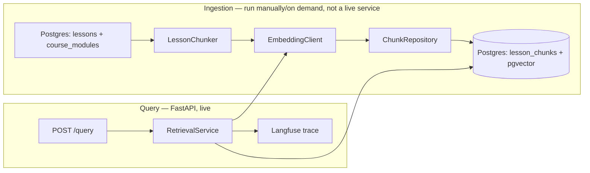
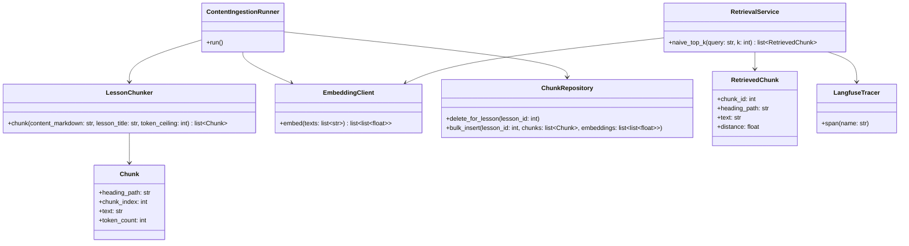
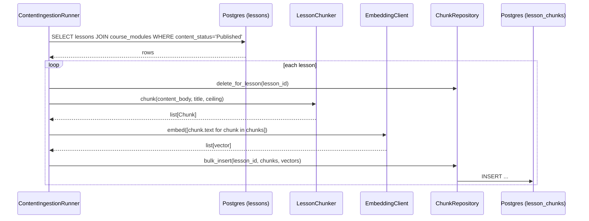
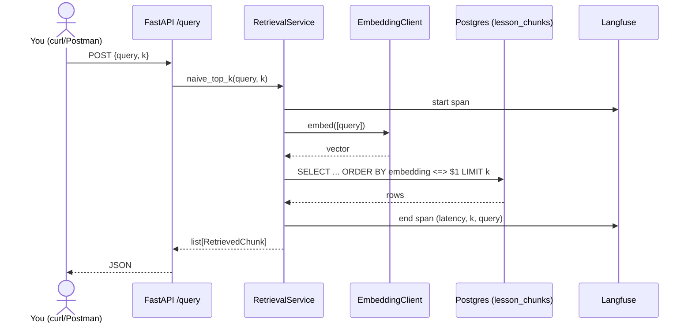

# Week 1–2 Design Overview — Naive RAG Baseline (hand-coded by user)

**Status:** Design reference only. No implementation code here — the user writes every file themselves. This scopes down the full HLD at [neuralascent-chatbot-hld-python-LangChain.md](Chatbot-implementation/architecture-notes/neuralascent-chatbot-hld-python-LangChain.md) to exactly what Weeks 1–2 of the AI-transition plan need: ingestion + naive top-k retrieval, nothing else. No auth, no routing, no guardrails, no chat UI, no reranking. This is deliberately the dumbest version that works — it's the control group the Week 3–8 eval work measures every later improvement against.

## What's different from the full HLD

The full HLD assumes a generic `vertical → course → chapter → lesson → exercise` hierarchy with its own `app_user`/`chat_conversation` tables. This repo's actual schema is simpler: `course_modules → lessons` (see `api/Models/CourseModule.cs`, `api/Models/Lesson.cs`), no separate vertical/chapter layer. Don't copy the HLD's §12 SQL verbatim — adapt column names to what actually exists (`lessons.content_body`, `lessons.content_status`, `course_modules.slug`/`title`).

## Component overview

Two independent flows sharing one table. Nothing else exists yet — no orchestrator, no LLM answer generation, no session/conversation state. `/query` returns ranked raw chunks; a human (you) reads the JSON to judge quality. Answer synthesis is Week 7.

## Class diagram

Five classes, one script, one endpoint. That's the whole Week 1–2 build. Resist the urge to add `RoutePolicyEngine`, `ContextResolver`, or `ResponseGuardrail` from the full HLD now — those are Weeks 9–13 material once there's an eval harness to prove they're needed.

## Sequence — ingestion (run by hand, e.g. `python -m ingestion.run`)

## Sequence — query

## Build order (what to write first, in order)

1. **Migration**: `lesson_chunks` table + `vector` extension. Point of friction to know now: `postgres:16-alpine` (current `database` image in `docker-compose.yml`) does not ship pgvector — you'll need to switch to `pgvector/pgvector:pg16` before this table can exist. Small, mechanical compose change; still yours to make since it's part of standing the feature up.
2. **`LessonChunker`** — pure function, no I/O. Write it test-first: paste in a real `content_body` from one lesson, assert the heading paths and chunk boundaries look right before wiring anything else.
3. **`EmbeddingClient`** — thin wrapper, one method, easy to fake in tests.
4. **`ChunkRepository` + `ContentIngestionRunner`** — wire the above three into one script, run it against real lesson data, eyeball what landed in `lesson_chunks`.
5. **`RetrievalService` + `/query` endpoint** — cosine search via pgvector's `<=>` operator (see the full HLD §12.1 for the operator in context, adapt the query to the simpler schema here).
6. **Langfuse tracing** — wrap step 5's call. Self-hosting Langfuse itself is infra setup, not "the job" — fine to follow Langfuse's own self-host docs directly rather than treating it as a design problem.

Nothing here produces an answer to a learner's question yet — that's deliberate. The measuring instrument (Week 3's golden eval set) comes before you're allowed to make this fancier.
