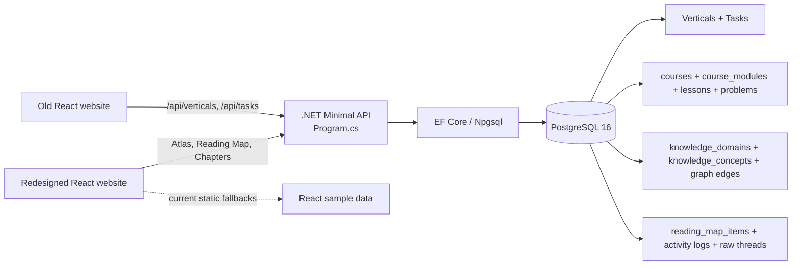
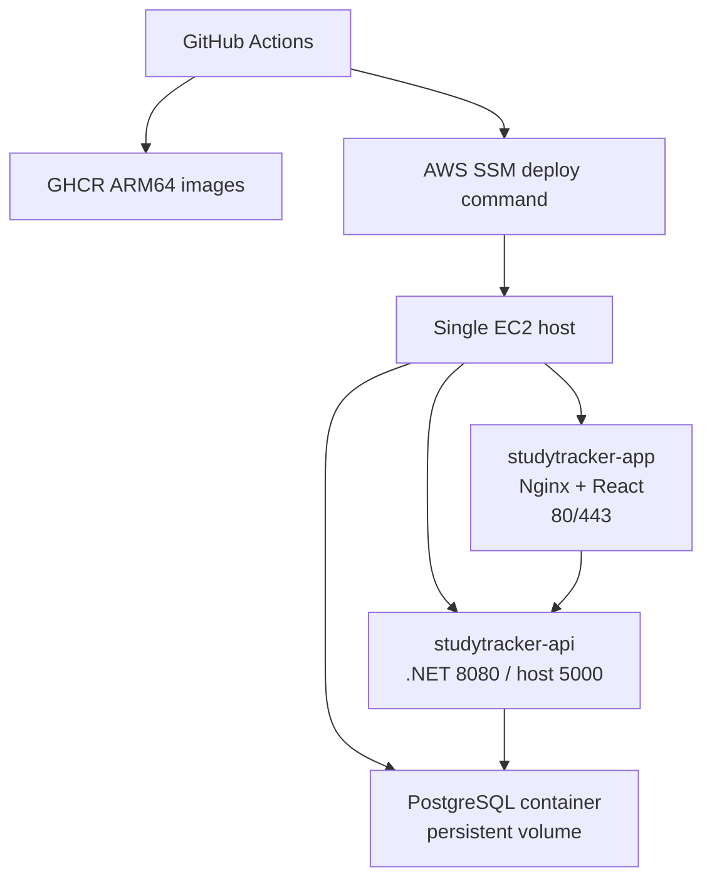
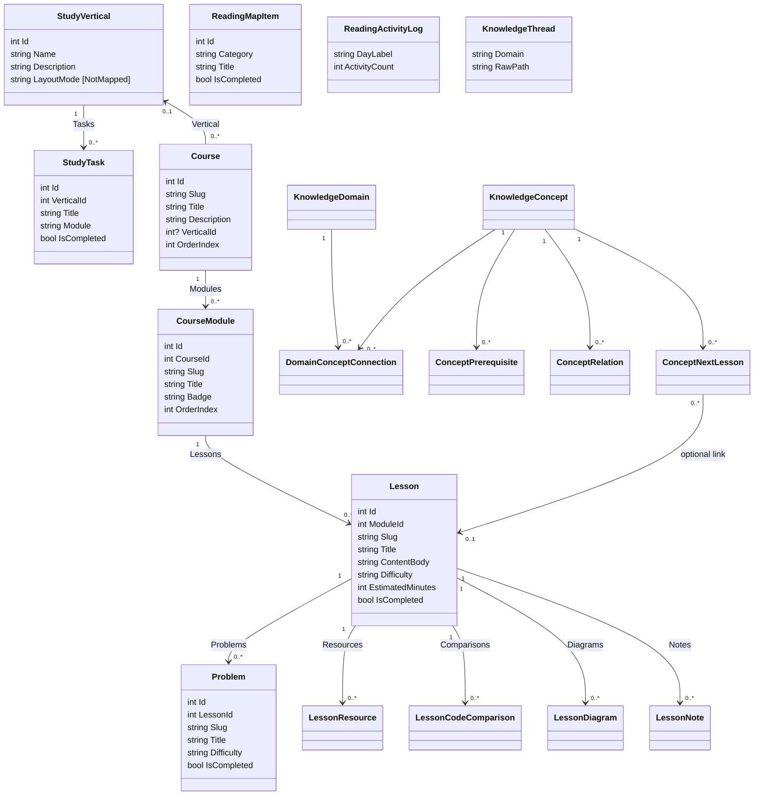
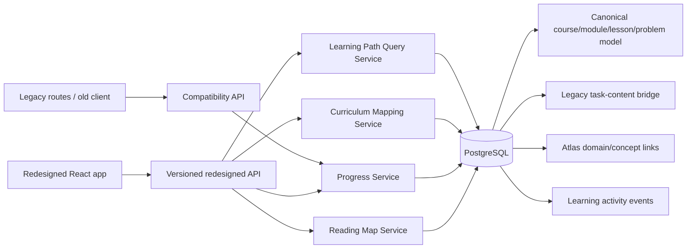
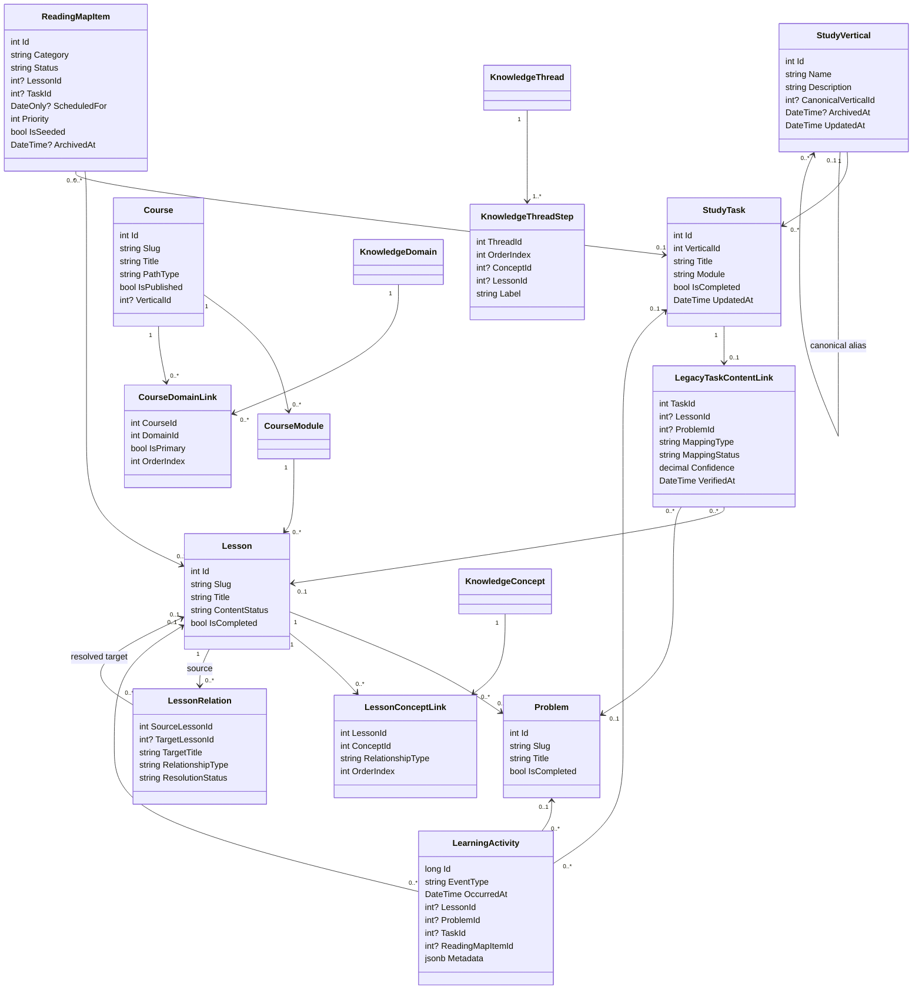
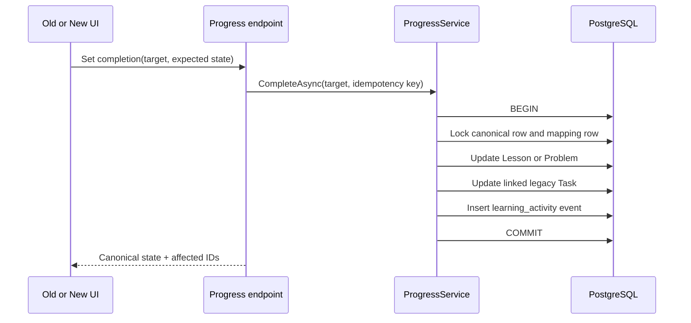
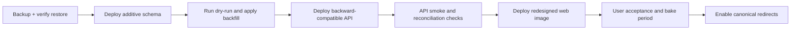

# Neuralascent Technical Migration Architecture

**Status:** Proposed implementation blueprint

**Prepared:** 2026-08-23

**Repository HEAD reviewed:** `a0d02fc`

**Application implementation baseline:** `7102e4d` (`a0d02fc` only adds the reference documents)

**Old-site baseline:** `8ac02c2947c3e3096f78517266bb4beb7d9d1969`

**Local-LLM prompt pack:** [`local-llm-migration-prompts.md`](local-llm-migration-prompts.md)

**Execution tracker:** [`migration-execution-tracker.md`](migration-execution-tracker.md)

## 1. Executive decision

This is a **semantically large but physically small** migration.

- The PostgreSQL row count is small, so additive DDL and backfill execution should complete in seconds or minutes.
- The difficult work is deciding what each old task means in the redesigned information architecture, preserving progress, removing misleading fallback data, and cutting over every route without losing content.
- The old frontend will not be scraped, embedded, or called by the redesigned frontend. Both applications will use the .NET API and the same PostgreSQL database during the transition.
- `Course → CourseModule → Lesson/Problem` becomes the canonical curriculum model.
- `StudyVertical → StudyTask` remains available as the legacy compatibility model until every old item has a verified canonical destination.
- No destructive table or row removal belongs in the initial migration.

### Estimated size

| Delivery level | Scope | Estimate |
|---|---|---:|
| Safe connection MVP | Migration hardening, bridge schema, Java/FDE mappings, v2 read APIs, Home/path navigation, progress synchronization, explicit error states | 15–22 engineer-days |
| Full migration | All MVP work plus Azure, Labs, Reading Map events, normalized threads, importer relationships, all route cutovers, rehearsal and production acceptance | 24–40 engineer-days |
| Content authoring | Writing complete chapter bodies for FDE's 104 outline items | Separate editorial effort; not included above |

For one senior engineer, the full migration is approximately **5–8 calendar weeks**, including review, deployment rehearsals, and contingency. With two engineers working on API/data and React in parallel, it is approximately **3–5 calendar weeks**. Add 20% contingency if the production database differs materially from the checked-in seed model.

## 2. Scope boundaries

### Included

- PostgreSQL schema evolution and backfill.
- EF Core entity/configuration changes.
- Legacy-to-canonical curriculum links.
- Completion synchronization.
- Knowledge Atlas, Reading Map, chapter, project, certification, profile, and importer route migration.
- Backward-compatible API rollout.
- Production backup, reconciliation, observability, rollback, and acceptance.

### Not included in the first cutover

- Deleting `Verticals` or `Tasks`.
- Rewriting all 104 FDE outlines into complete long-form chapters.
- Multi-user account design. The current product is effectively a single-owner tracker.
- Rebuilding old radar, donut, or maturity dashboard visuals.
- Renaming every mixed-case legacy PostgreSQL column in the same release.

## 3. Current-state architecture



### Current deployment



### Current technical risks

1. `Database.Migrate()` is called in `Program.cs` and again inside `DbSeeder.Initialize()`.
2. Both migration paths catch and suppress exceptions, allowing the process to continue against an incomplete schema.
3. `/health` checks only `CanConnectAsync()` and can report healthy while required tables or columns are absent.
4. `DbSeeder` executes emergency raw DDL during every startup, mixing schema migration, repair, and reference-data seeding.
5. `POST /api/chapters/map` accepts prerequisites, related concepts, and next lessons but does not persist them.
6. The importer can silently place an unrelated chapter in `java-spring-lld` or the first course.
7. Several React pages display production-looking sample data after an API failure.
8. `ChapterReader` does not consistently use `VITE_API_BASE_URL` or the API-key header.
9. The browser receives `VITE_API_KEY`; a build-time browser key is visible to users and must not be treated as real authentication.
10. The old and redesigned completion fields have no synchronization contract.

## 4. Current domain class diagram



### The missing connections

The current schema cannot answer these questions reliably:

- Which canonical lesson or practice problem represents a legacy `StudyTask`?
- Which courses belong to an Atlas domain?
- Which concepts are taught by a lesson?
- Which Reading Map item points to real curriculum content?
- Which real event produced an activity count?
- Which concept or lesson is each node in a knowledge thread?

## 5. Target architecture



### Target service boundaries

| Service | Responsibility |
|---|---|
| `LearningPathQueryService` | Compose Course, modules, lessons, progress, domain links, and unresolved outlines into read DTOs. |
| `CurriculumMappingService` | Resolve explicit path/module destinations, create/update lessons, concepts, and relationships idempotently. |
| `ProgressService` | Change canonical completion and synchronize linked legacy task/problem/lesson state in one transaction. |
| `ReadingMapService` | Manage linked queue entries and aggregate real activity events. |
| `AtlasQueryService` | Return data-driven domains/concepts with canonical learning-path and lesson destinations. |
| `MigrationReconciliationService` | Perform repeatable backfills, record mappings/issues, and produce before/after reports. |

The first implementation may keep Minimal APIs, but endpoint handlers should delegate to these services. New migration logic must not be added as another large block in `Program.cs`.

## 6. Target domain class diagram



## 7. Canonical ownership rules

| Concern | Canonical source after mapping | Compatibility behavior |
|---|---|---|
| Path/module/title | Course/Module/Lesson | Legacy title remains unchanged until retirement. |
| Lesson completion | `Lesson.IsCompleted` | Linked `StudyTask.IsCompleted` mirrors it transactionally. |
| Practice completion | `Problem.IsCompleted` | Linked Java problem task mirrors it transactionally. |
| Unmapped task completion | `StudyTask.IsCompleted` | Remains old-model-only until mapped. |
| Atlas placement | Course-domain and lesson-concept links | React constants cease to define graph membership. |
| Reading queue | Linked `ReadingMapItem` | Manual unlinked entries remain allowed. |
| Activity history | `learning_activity` events | Existing seeded daily counts are displayed only as demo data until archived. |
| Chapter authoring | Lesson plus normalized links | No fallback into an arbitrary course. |

### Progress write transaction



Use explicit `completed: true|false`; do not use “toggle” semantics in v2 because retries can invert state twice. Keep old toggle endpoints as adapters that resolve current state and call the explicit service.

## 8. PostgreSQL schema definition

The following is the target additive DDL. EF Core migrations should generate equivalent SQL. It deliberately preserves the current mixed legacy naming (`"Verticals"`, `"Tasks"`, and Pascal-case Reading Map columns) while new tables and columns use lower snake case.

### 8.1 Legacy compatibility metadata

```sql
ALTER TABLE "Verticals"
    ADD COLUMN IF NOT EXISTS canonical_vertical_id integer NULL,
    ADD COLUMN IF NOT EXISTS archived_at timestamptz NULL,
    ADD COLUMN IF NOT EXISTS updated_at timestamptz NOT NULL DEFAULT now();

ALTER TABLE "Verticals"
    ADD CONSTRAINT fk_verticals_canonical_vertical
    FOREIGN KEY (canonical_vertical_id)
    REFERENCES "Verticals"("Id")
    ON DELETE RESTRICT;

CREATE INDEX IF NOT EXISTS ix_verticals_canonical_vertical_id
    ON "Verticals"(canonical_vertical_id);

ALTER TABLE "Tasks"
    ADD COLUMN IF NOT EXISTS updated_at timestamptz NOT NULL DEFAULT now();
```

Do not populate `canonical_vertical_id` until the production rows for FDE Curriculum and FDE Self-Study have been reconciled.

### 8.2 Canonical path status

```sql
ALTER TABLE courses
    ADD COLUMN IF NOT EXISTS path_type varchar(32) NOT NULL DEFAULT 'Course',
    ADD COLUMN IF NOT EXISTS is_published boolean NOT NULL DEFAULT true;

ALTER TABLE courses
    ADD CONSTRAINT ck_courses_path_type
    CHECK (path_type IN ('Course', 'Certification', 'Project'));

ALTER TABLE lessons
    ADD COLUMN IF NOT EXISTS content_status varchar(32) NOT NULL DEFAULT 'Published';

ALTER TABLE lessons
    ADD CONSTRAINT ck_lessons_content_status
    CHECK (content_status IN ('Outline', 'Draft', 'Published', 'Archived'));
```

FDE, Azure, and Lab items may initially become `Outline` lessons. This preserves their titles, order, module, and progress without pretending that a complete chapter body exists.

### 8.3 Course-to-domain links

```sql
CREATE TABLE IF NOT EXISTS course_domain_links (
    course_id integer NOT NULL REFERENCES courses(id) ON DELETE CASCADE,
    domain_id integer NOT NULL REFERENCES knowledge_domains(id) ON DELETE CASCADE,
    is_primary boolean NOT NULL DEFAULT false,
    order_index integer NOT NULL DEFAULT 0,
    created_at timestamptz NOT NULL DEFAULT now(),
    PRIMARY KEY (course_id, domain_id)
);

CREATE INDEX IF NOT EXISTS ix_course_domain_links_domain_id
    ON course_domain_links(domain_id, order_index);
```

### 8.4 Lesson-to-concept and lesson-to-lesson links

```sql
CREATE TABLE IF NOT EXISTS lesson_concept_links (
    lesson_id integer NOT NULL REFERENCES lessons(id) ON DELETE CASCADE,
    concept_id integer NOT NULL REFERENCES knowledge_concepts(id) ON DELETE CASCADE,
    relationship_type varchar(32) NOT NULL DEFAULT 'Related',
    order_index integer NOT NULL DEFAULT 0,
    created_at timestamptz NOT NULL DEFAULT now(),
    PRIMARY KEY (lesson_id, concept_id, relationship_type),
    CONSTRAINT ck_lesson_concept_relationship
        CHECK (relationship_type IN ('Primary', 'Related', 'PrerequisiteContext'))
);

CREATE INDEX IF NOT EXISTS ix_lesson_concept_links_concept
    ON lesson_concept_links(concept_id, relationship_type, order_index);

CREATE TABLE IF NOT EXISTS lesson_relations (
    id bigserial PRIMARY KEY,
    source_lesson_id integer NOT NULL REFERENCES lessons(id) ON DELETE CASCADE,
    target_lesson_id integer NULL REFERENCES lessons(id) ON DELETE SET NULL,
    target_title varchar(300) NOT NULL,
    target_slug varchar(150) NULL,
    relationship_type varchar(32) NOT NULL,
    resolution_status varchar(32) NOT NULL DEFAULT 'Unresolved',
    order_index integer NOT NULL DEFAULT 0,
    created_at timestamptz NOT NULL DEFAULT now(),
    updated_at timestamptz NOT NULL DEFAULT now(),
    CONSTRAINT ck_lesson_relation_type
        CHECK (relationship_type IN ('Prerequisite', 'Related', 'Next')),
    CONSTRAINT ck_lesson_relation_resolution
        CHECK (resolution_status IN ('Unresolved', 'Resolved', 'External')),
    CONSTRAINT ck_lesson_relation_target
        CHECK (target_lesson_id IS NOT NULL OR length(trim(target_title)) > 0)
);

CREATE UNIQUE INDEX IF NOT EXISTS ux_lesson_relations_identity
    ON lesson_relations
       (source_lesson_id, relationship_type, lower(target_title));

CREATE INDEX IF NOT EXISTS ix_lesson_relations_target_lesson
    ON lesson_relations(target_lesson_id)
    WHERE target_lesson_id IS NOT NULL;
```

### 8.5 Legacy task-to-content bridge

```sql
CREATE TABLE IF NOT EXISTS study_task_content_links (
    task_id integer PRIMARY KEY REFERENCES "Tasks"("Id") ON DELETE CASCADE,
    lesson_id integer NULL REFERENCES lessons(id) ON DELETE RESTRICT,
    problem_id integer NULL REFERENCES problems(id) ON DELETE RESTRICT,
    mapping_type varchar(32) NOT NULL DEFAULT 'TitleAndModule',
    mapping_status varchar(32) NOT NULL DEFAULT 'Proposed',
    confidence numeric(5,4) NOT NULL DEFAULT 1.0000,
    source_checksum varchar(64) NOT NULL,
    verified_at timestamptz NULL,
    created_at timestamptz NOT NULL DEFAULT now(),
    updated_at timestamptz NOT NULL DEFAULT now(),
    CONSTRAINT ck_task_content_exactly_one_target
        CHECK (num_nonnulls(lesson_id, problem_id) = 1),
    CONSTRAINT ck_task_content_mapping_type
        CHECK (mapping_type IN ('Exact', 'TitleAndModule', 'Manual', 'DuplicateAlias')),
    CONSTRAINT ck_task_content_mapping_status
        CHECK (mapping_status IN ('Proposed', 'Verified', 'Rejected')),
    CONSTRAINT ck_task_content_confidence
        CHECK (confidence >= 0 AND confidence <= 1)
);

CREATE INDEX IF NOT EXISTS ix_task_content_links_lesson
    ON study_task_content_links(lesson_id)
    WHERE lesson_id IS NOT NULL;

CREATE INDEX IF NOT EXISTS ix_task_content_links_problem
    ON study_task_content_links(problem_id)
    WHERE problem_id IS NOT NULL;
```

`lesson_id` is intentionally not unique. If production proves that the two FDE verticals duplicate each other, two legacy tasks may temporarily point to one canonical lesson.

### 8.6 Linked Reading Map and real activity

```sql
ALTER TABLE reading_map_items
    ADD COLUMN IF NOT EXISTS lesson_id integer NULL,
    ADD COLUMN IF NOT EXISTS task_id integer NULL,
    ADD COLUMN IF NOT EXISTS status varchar(32) NOT NULL DEFAULT 'Planned',
    ADD COLUMN IF NOT EXISTS scheduled_for date NULL,
    ADD COLUMN IF NOT EXISTS priority integer NOT NULL DEFAULT 0,
    ADD COLUMN IF NOT EXISTS is_seeded boolean NOT NULL DEFAULT false,
    ADD COLUMN IF NOT EXISTS archived_at timestamptz NULL;

ALTER TABLE reading_map_items
    ADD CONSTRAINT fk_reading_map_lesson
        FOREIGN KEY (lesson_id) REFERENCES lessons(id) ON DELETE SET NULL,
    ADD CONSTRAINT fk_reading_map_task
        FOREIGN KEY (task_id) REFERENCES "Tasks"("Id") ON DELETE SET NULL,
    ADD CONSTRAINT ck_reading_map_status
        CHECK (status IN ('Planned', 'Reading', 'Completed', 'Revisited', 'Deferred', 'Archived')),
    ADD CONSTRAINT ck_reading_map_priority
        CHECK (priority BETWEEN 0 AND 100);

CREATE INDEX IF NOT EXISTS ix_reading_map_status_schedule
    ON reading_map_items(status, scheduled_for, priority DESC)
    WHERE archived_at IS NULL;

CREATE TABLE IF NOT EXISTS learning_activity (
    id bigserial PRIMARY KEY,
    event_type varchar(40) NOT NULL,
    occurred_at timestamptz NOT NULL DEFAULT now(),
    lesson_id integer NULL REFERENCES lessons(id) ON DELETE SET NULL,
    problem_id integer NULL REFERENCES problems(id) ON DELETE SET NULL,
    task_id integer NULL REFERENCES "Tasks"("Id") ON DELETE SET NULL,
    reading_map_item_id integer NULL REFERENCES reading_map_items("Id") ON DELETE SET NULL,
    correlation_id uuid NOT NULL,
    metadata jsonb NOT NULL DEFAULT '{}'::jsonb,
    CONSTRAINT ck_learning_activity_event_type
        CHECK (event_type IN (
            'LessonCompleted', 'LessonReopened',
            'ProblemCompleted', 'ProblemReopened',
            'TaskCompleted', 'TaskReopened',
            'ReadingScheduled', 'ReadingDeferred', 'ReadingRevisited',
            'NoteCreated', 'ChapterImported'
        ))
);

CREATE UNIQUE INDEX IF NOT EXISTS ux_learning_activity_correlation_event
    ON learning_activity(correlation_id, event_type);

CREATE INDEX IF NOT EXISTS ix_learning_activity_occurred_at
    ON learning_activity(occurred_at DESC);

CREATE INDEX IF NOT EXISTS ix_learning_activity_lesson
    ON learning_activity(lesson_id, occurred_at DESC)
    WHERE lesson_id IS NOT NULL;
```

The uniqueness on `correlation_id + event_type` makes retried writes idempotent. Activity charts must aggregate `occurred_at`; `reading_activity_logs` remains compatibility/demo data until it is retired.

### 8.7 Normalized knowledge threads

```sql
CREATE TABLE IF NOT EXISTS knowledge_thread_steps (
    thread_id integer NOT NULL REFERENCES knowledge_threads("Id") ON DELETE CASCADE,
    order_index integer NOT NULL,
    concept_id integer NULL REFERENCES knowledge_concepts(id) ON DELETE SET NULL,
    lesson_id integer NULL REFERENCES lessons(id) ON DELETE SET NULL,
    label varchar(250) NOT NULL,
    created_at timestamptz NOT NULL DEFAULT now(),
    PRIMARY KEY (thread_id, order_index),
    CONSTRAINT ck_knowledge_thread_step_label
        CHECK (length(trim(label)) > 0)
);

CREATE INDEX IF NOT EXISTS ix_knowledge_thread_steps_concept
    ON knowledge_thread_steps(concept_id)
    WHERE concept_id IS NOT NULL;
```

Keep `KnowledgeThread.RawPath` during compatibility. New writes create steps first and derive the display path.

### 8.8 Migration audit and reconciliation

```sql
CREATE TABLE IF NOT EXISTS migration_reconciliation (
    id bigserial PRIMARY KEY,
    migration_key varchar(100) NOT NULL,
    source_type varchar(50) NOT NULL,
    source_id varchar(100) NOT NULL,
    target_type varchar(50) NULL,
    target_id varchar(100) NULL,
    source_checksum varchar(64) NOT NULL,
    status varchar(32) NOT NULL,
    issue_code varchar(100) NULL,
    details jsonb NOT NULL DEFAULT '{}'::jsonb,
    applied_at timestamptz NULL,
    updated_at timestamptz NOT NULL DEFAULT now(),
    CONSTRAINT ck_migration_reconciliation_status
        CHECK (status IN ('Discovered', 'Mapped', 'Applied', 'Verified', 'Conflict', 'Skipped')),
    UNIQUE (migration_key, source_type, source_id)
);

CREATE INDEX IF NOT EXISTS ix_migration_reconciliation_status
    ON migration_reconciliation(migration_key, status);
```

This table is operational evidence. It allows a migration to resume safely and gives reviewers an explicit conflict list instead of hiding failed mappings in logs.

## 9. EF Core implementation changes

### New entity classes

```text
Models/
  CourseDomainLink.cs
  LessonConceptLink.cs
  LessonRelation.cs
  StudyTaskContentLink.cs
  LearningActivity.cs
  KnowledgeThreadStep.cs
  MigrationReconciliation.cs
```

### Existing class changes

| Class | Additions |
|---|---|
| `StudyVertical` | `CanonicalVerticalId`, `CanonicalVertical`, `Aliases`, `ArchivedAt`, `UpdatedAt`. |
| `StudyTask` | `UpdatedAt`, optional one-to-one `ContentLink`. |
| `Course` | `PathType`, `IsPublished`, `DomainLinks`. |
| `Lesson` | `ContentStatus`, `ConceptLinks`, outgoing/incoming relations, optional legacy links. |
| `Problem` | Optional legacy task links. |
| `KnowledgeDomain` | `CourseLinks`. |
| `KnowledgeConcept` | `LessonLinks`, while retaining current concept graph relationships. |
| `ReadingMapItem` | Canonical links, status/schedule/priority/seed/archive metadata. |
| `KnowledgeThread` | `Steps`. |

### `DbContext` configuration requirements

- Use explicit table and column names for every new entity.
- Use composite keys for pure relationship tables.
- Configure `DeleteBehavior.Restrict` from the legacy bridge to canonical content so deleting a lesson cannot silently orphan old progress.
- Use `SetNull` for optional Reading Map/activity links.
- Apply all check constraints through migrations.
- Add `AsNoTracking()` to composed read queries.
- Add database integration tests for each delete behavior and uniqueness rule.

## 10. Migration release sequence

Each migration is additive. A failed application release can roll back to the previous API/frontend binaries while leaving the new schema in place.

| Order | EF migration / release | Purpose | Destructive? |
|---:|---|---|---|
| 1 | `HardenMigrationExecution` | Code release: one migration path, fail-fast readiness, remove startup raw-DDL repair. | No |
| 2 | `AddCurriculumBridgeSchema` | Path type, content status, course-domain, lesson-concept, lesson relations, task-content bridge. | No |
| 3 | `AddLinkedReadingAndActivity` | Reading links/status and real activity events. | No |
| 4 | `NormalizeKnowledgeThreads` | Add thread steps while keeping `RawPath`. | No |
| 5 | `AddMigrationReconciliation` | Add resumable migration audit. | No |
| 6 | Content backfill command v1 | Java exact mappings, FDE/Azure/Lab outlines, Atlas links. | Inserts/updates only |
| 7 | `TightenVerifiedMappingConstraints` | Optional constraints only after reconciliation reaches its gate. | No row deletion |
| 8 | Cleanup release, much later | Archive/remove prototype rows and obsolete code after acceptance. | Potentially; separate approval |

Do not place environment-specific content matching in an EF `Up()` method. EF migrations create the schema. A versioned reconciliation command performs data discovery/backfill and writes its audit rows.

## 11. Phase-by-phase execution plan

### Phase 0 — Discovery, freeze, and recovery proof

**Estimated effort:** 1–2 days

#### 0.1 Production inventory

Capture from production:

- applied EF migration IDs;
- PostgreSQL version and database size;
- row counts for every current table;
- all vertical IDs, names, task counts, and completed counts;
- course/module/lesson/problem counts and completion;
- duplicate title/module candidates;
- orphan FK checks;
- current API and app image digests.

#### 0.2 Backup and restore rehearsal

- Create a timestamped `pg_dump` in custom format.
- Copy it outside the PostgreSQL container volume.
- Restore it into an isolated rehearsal database.
- Run row-count and checksum queries against the restore.
- Record restore duration and exact recovery commands.

#### 0.3 Change policy

- Freeze manual seed edits during the backfill window.
- If the old site remains writable, record a final watermark timestamp and perform a delta reconciliation before cutover.
- No delete/merge decision is approved from UI similarity alone.

#### Exit gate

- Restore has been proven.
- Production inventory report is checked into a private deployment artifact or secure operational location.
- Differences from the repository seed model are listed.

### Phase 1 — Migration and runtime hardening

**Estimated effort:** 2–3 days

#### 1.1 Separate lifecycle modes

Implement explicit process modes:

```text
dotnet StudyTracker.Api.dll --migrate
dotnet StudyTracker.Api.dll --seed-reference-data
dotnet StudyTracker.Api.dll
```

- `--migrate`: run `Database.MigrateAsync()` once and fail with a non-zero exit code.
- `--seed-reference-data`: idempotent reference seeds only; no DDL and no swallowed exceptions.
- normal API: validate migration readiness and start serving; never repair schema silently.

#### 1.2 Remove unsafe startup behavior

- Remove the second `Migrate()` call from `DbSeeder.Initialize()`.
- Remove the raw `ALTER TABLE` / `CREATE TABLE` repair block after equivalent formal migrations are verified.
- Replace `Console.WriteLine` migration notices with structured logs and process failure.

#### 1.3 Health endpoints

- `/health/live`: process is running; no database dependency.
- `/health/ready`: database reachable, expected migration is applied, required schema query succeeds.
- Keep `/health` as a temporary alias to readiness for Docker compatibility.

#### 1.4 API error and security baseline

- Add centralized RFC 7807 Problem Details responses.
- Add correlation IDs to requests and logs.
- Move browser traffic to same-origin `/api` through Nginx.
- Do not rely on `VITE_API_KEY` as authentication. Prefer Nginx injecting an internal upstream key and blocking direct public API mutation access, or add real owner authentication before exposing writes publicly.

#### Exit gate

- A deliberately broken migration prevents readiness and deployment.
- The previous API can still run against the additive schema.
- Seed execution is idempotent in an empty and populated database.

### Phase 2 — Additive canonical bridge schema

**Estimated effort:** 3–5 days

#### 2.1 Add entities and configuration

Create the schema from Section 8 and matching C# entities/configurations.

#### 2.2 Add DTOs without changing old contracts

Introduce v2 DTOs:

```text
LearningPathSummaryDto
LearningPathDetailDto
LearningModuleDto
LearningItemDto
AtlasNodeDestinationDto
SetProgressRequest
ProgressResultDto
MappedChapterRequest / MappedChapterResult
MigrationConflictDto
```

#### 2.3 Migration verification tests

- Migrate a fresh empty database from migration zero.
- Upgrade a restored old production database.
- Run migrations twice to prove no second-run side effects.
- Verify all new FKs and check constraints.
- Verify old API contract tests still pass before any backfill.

#### Exit gate

- New schema exists with zero required backfill rows.
- Old site and old API continue working unchanged.
- Downgrading the application binaries remains possible without reversing schema.

### Phase 3 — Data reconciliation and backfill

**Estimated effort:** 5–8 days

#### 3.1 Build the reconciliation command

Create an API-hosted command or separate console entry point:

```text
dotnet StudyTracker.Api.dll --reconcile-content --dry-run
dotnet StudyTracker.Api.dll --reconcile-content --apply
dotnet StudyTracker.Api.dll --reconcile-content --verify
```

Properties:

- deterministic normalization of slugs/titles;
- checksum-based idempotency;
- transaction per aggregate/path, not one unbounded transaction;
- dry-run report with no writes;
- conflict rows written to `migration_reconciliation` only during apply/verify;
- rerunnable after interruption.

#### 3.2 Java mapping first

Java is the pilot because canonical Course/Module/Lesson/Problem data already exists.

- Map 13 legacy lesson tasks to their corresponding lessons.
- Map five OOP-2 practice tasks to `Problem` rows.
- Review the remaining four Spring/capstone tasks against existing canonical lessons; create `Outline` lessons only where no target exists.
- Assert that 8/22 live progress remains 8/22 after mapping.
- Link Java course to Foundations, Backend, and Reliability domains.
- Link concurrency lessons to the Concurrency concept.

#### 3.3 FDE reconciliation

- Compare FDE Curriculum and FDE Self-Study by normalized `(module, title)` and completion.
- Produce four sets: exact duplicate, status conflict, source-only, target-only.
- Do not choose a canonical vertical until status conflicts are reviewed.
- Create one canonical FDE Course with nine modules: prerequisite plus modules 1–8.
- Create 104 `Outline` lessons from the approved canonical source.
- Link both duplicate legacy tasks to the same canonical lesson only when title/module identity is verified.
- Preserve the most advanced completion state only after conflict review; never silently overwrite a completed row with incomplete.
- Add `canonical_vertical_id` and `archived_at` only after route redirect acceptance.

#### 3.4 Azure and Labs

- Create an Azure path with `path_type = 'Certification'` and two outline lessons.
- Create a Labs path with `path_type = 'Project'` and the two project items.
- Keep the FDE specialization dashboard semantics separate from the two actual Lab Project records.

#### 3.5 Atlas and lesson relationships

- Populate course-domain links from the approved mapping matrix.
- Populate lesson-concept links from exact curriculum terms first.
- Backfill `ConceptNextLesson.LessonId` for resolvable current links.
- Mark unresolved text links explicitly; do not create fake lesson records solely to satisfy an FK.

#### 3.6 Reading Map and threads

- Mark existing prototype Reading Map rows `is_seeded = true`.
- Link exact Java/concurrency rows where possible.
- Split each raw knowledge thread into ordered steps and attach known concept/lesson IDs.
- Do not manufacture historical `learning_activity` events from seeded daily counts.

#### Exit gate

- 100% of old tasks are classified as Verified, Proposed, Conflict, or intentionally Unmapped.
- Java verified mapping is 100%.
- FDE mapping conflicts are zero or explicitly approved exceptions.
- Before/after counts and completion reports match approved rules.

### Phase 4 — API compatibility and redesigned APIs

**Estimated effort:** 5–8 days

#### 4.1 Compatibility API

Keep these contracts for the old client:

- `GET /api/verticals`
- `GET /api/verticals/{id}`
- `PUT /api/tasks/{id}/toggle`
- existing Java lesson/problem reads

Change their internals so mapped completion writes call `ProgressService`.

#### 4.2 New v2 read APIs

```http
GET /api/v2/learning-paths
GET /api/v2/learning-paths/{slug}
GET /api/v2/knowledge-atlas
GET /api/v2/reading-map
GET /api/v2/chapters/{courseSlug}/{moduleSlug}/{lessonSlug}
GET /api/v2/migration/status              # owner/admin only
```

Required response characteristics:

- stable slugs and canonical URLs;
- server-computed completion counts;
- explicit `contentStatus` for outline/draft/published lessons;
- destinations for Atlas nodes;
- no React-specific display assumptions;
- ETags or `updatedAt` for cache/concurrency support.

#### 4.3 Explicit progress APIs

```http
PUT /api/v2/lessons/{id}/completion
PUT /api/v2/problems/{id}/completion
PUT /api/v2/tasks/{id}/completion

{
  "completed": true,
  "correlationId": "uuid"
}
```

Return the canonical state and all synchronized legacy IDs. Retried correlation IDs return the original result.

#### 4.4 Correct chapter mapping

Replace the current loose request with explicit IDs/slugs:

```json
{
  "courseSlug": "fde-self-study",
  "moduleSlug": "backend-engineering",
  "title": "Postgres Internals",
  "slug": "postgres-internals",
  "markdownContent": "...",
  "contentStatus": "Draft",
  "conceptSlugs": ["databases"],
  "prerequisiteLessonSlugs": [],
  "relatedLessonSlugs": [],
  "nextLessonSlugs": [],
  "idempotencyKey": "uuid"
}
```

Rules:

- Course and module must resolve exactly or the request fails.
- Creating a new course/module requires separate explicit endpoints/permission.
- Persist all relationship fields.
- The response includes every persisted ID and canonical URL.
- No fallback to `/api/verticals/ingest` after a mapping failure.

#### 4.5 Contract and integration tests

- Golden-file tests for old endpoints before/after service refactor.
- PostgreSQL integration tests for synchronized writes and idempotency.
- API tests for unresolved importer relationships.
- Authorization tests for every mutation.

#### Exit gate

- Old UI works against the new API build.
- New API returns only real database data.
- Completion changes remain consistent regardless of which client initiates them.

### Phase 5 — Webpage migration

**Estimated effort:** 7–12 days

#### 5.1 Shared frontend infrastructure

- Create one `apiClient` that applies base URL, headers, correlation ID, timeout, and Problem Details parsing.
- Add loading, empty, degraded, and error states.
- Allow static sample data only under an explicit development/demo flag.
- Add route-level error boundaries.
- Add analytics/log correlation without sending sensitive content.

#### 5.2 Home / Knowledge Atlas

**Old content to preserve:** discovery of all five vertical cards and their progress.

**New representation:** Atlas plus a compact Learning Paths index.

- Fetch `/api/v2/knowledge-atlas` and `/api/v2/learning-paths`.
- Remove canonical graph-node arrays as the production source.
- Render added domains/concepts dynamically.
- Make every relevant node or path navigate to a canonical destination.
- Preserve path counts without restoring donut/radar dashboard chrome.

#### 5.3 Learning Path page

Add:

```text
/learning-paths/:slug
```

- Editorial path header, description, progress, modules, lesson status, estimated reading time, and Atlas domains.
- Outline lessons are visibly labelled and must not impersonate complete chapters.
- Java, FDE, Azure, and Labs all use the same path shell with `pathType` variations.

#### 5.4 Reading Map

- Route `/reading-map` directly to `ReadingMap`, not `LabProjects`.
- Use linked lesson/task destinations.
- Aggregate activity from `/api/v2/reading-map`.
- Replace prototype counts with server-computed collection counts.
- Keep manual entries but identify them as manual.

#### 5.5 Lab Projects

- Restore `/lab-projects` as a distinct Projects path/page.
- Render WMS Defect Detection and Unity Localization Platform.
- Decide whether the old FDE competence dashboard becomes an FDE path summary or is retired; it must not overwrite the actual two-project data.

#### 5.6 Chapter Reader

- Use the shared API client and v2 canonical route.
- Preserve table of contents, prose, code comparisons, diagrams, resources, problems, notes, and previous/next navigation.
- Remove production-looking fallback chapters.
- If an API call fails, show an explicit error with retry.

#### 5.7 Curriculum Importer

- Load course/module/concept choices from the API.
- Require an explicit destination.
- Preview links that will be created.
- Display saved IDs and canonical URL only after database commit.
- Keep unsaved text as a visibly local draft; never label it as mapped.

#### 5.8 Profile and certifications

- Preserve all content captured in `website-comparison-baseline.md`.
- Remove the unused `/api/verticals` request unless real progress is displayed.
- Keep `/certifications → /profile` redirect.
- Profile storage can remain static during this migration; database normalization is a separate feature.

#### 5.9 Legacy routes

| Existing route | Migration behavior |
|---|---|
| `/vertical/:id` | Compatibility page or redirect adapter after verified mapping. |
| `/lab-projects` | Distinct Project path. |
| `/progress` | Redirect to `/reading-map`. |
| `/learning` | Redirect to a chapter library/path index, not a fixed chapter. |
| `/chapter/:slug` | Retain as a resolver, redirect to canonical hierarchical URL. |
| `/add-vertical`, `/map-chapter`, `/ingest` | Redirect to `/curriculum-import`. |

#### 5.10 Frontend acceptance

- Playwright route tests for desktop and mobile widths.
- No route silently displays sample data when the API is unavailable.
- Old URLs resolve or redirect without 404.
- All five old tracks are discoverable within two navigation actions.
- Completion updates are visible after reload and in the legacy route.

### Phase 6 — Deployment and cutover

**Estimated effort:** 2–4 days including rehearsal

#### 6.1 Release ordering



API/schema deploys before the new frontend because the old frontend must remain functional throughout.

#### 6.2 Deployment workflow changes

- Build immutable images tagged with commit SHA; deploy SHA tags, not mutable `latest` alone.
- Run the migration container as a one-shot step before starting the new API.
- Abort deployment if migration, readiness, or reconciliation gate fails.
- Record image digest, migration ID, backup path, and reconciliation summary.
- Do not prune all images before the bake period; retain at least the previous known-good API/app images for rollback.

#### 6.3 Feature flags

Recommended flags:

```text
LearningPathsV2
SynchronizedProgressWrites
ReadingActivityV2
CanonicalVerticalRedirects
StrictNoFallbackData
```

Flags should be server/configuration controlled where possible. They are rollback controls, not permanent branches.

#### 6.4 Rollback model

- All pre-cleanup schema changes are additive, so roll back API/app binaries without dropping tables.
- Disable v2 flags if a page fails while keeping old routes active.
- Restore the database only for confirmed data corruption, not for a frontend defect.
- If backfill mapping is wrong, mark mappings rejected and rerun reconciliation from the backup-derived report; do not delete canonical content blindly.

#### Exit gate

- Production smoke tests pass on all listed routes.
- API logs contain no missing-relation/missing-column/migration errors.
- Reconciliation counts match the approved report.
- A rollback rehearsal has succeeded before canonical redirects are enabled.

### Phase 7 — Bake, archive, and eventual cleanup

**Estimated effort:** 2–5 days, scheduled after a minimum acceptance period

#### 7.1 Bake period

Keep both models for at least one agreed usage cycle. Monitor:

- completion synchronization mismatches;
- unresolved mappings;
- API error rate and latency;
- fallback/demo-data activation, which should be zero in production;
- old route traffic;
- importer failures and unresolved relations.

#### 7.2 Archive candidates

- Prototype Reading Map rows after linked replacements exist.
- Seeded daily activity counts after real activity is displayed.
- Raw thread paths after normalized steps are stable.
- Duplicate FDE vertical only after canonical redirect and completion checks.
- Unused old React components after route analytics and acceptance.

#### 7.3 Physical deletion

Physical deletion or dropping legacy tables is a separate destructive migration requiring:

- explicit approval;
- a fresh backup;
- zero old-client traffic;
- 100% verified task-content mapping;
- a retention/export decision;
- a tested restore path.

The recommended initial outcome is to keep legacy rows archived rather than drop `Verticals` and `Tasks`.

## 12. Detailed old-to-new mapping

| Old source | Canonical target | Mapping rule | Progress rule |
|---|---|---|---|
| Java lesson task | Existing Java Lesson | Exact normalized lesson number/title/module | Lesson canonical; mirror task. |
| Java OOP practice task | Existing Problem | Exact problem ordinal/title | Problem canonical; mirror task. |
| Missing Java Spring task | New Outline Lesson | Exact module and generated stable slug | Lesson canonical after verification. |
| FDE task | FDE Outline Lesson | Exact module/title after duplicate reconciliation | Canonical lesson plus all verified legacy aliases. |
| Azure task | Certification Outline Lesson | Exact title under Azure module | Lesson canonical; mirror task. |
| Lab task | Project Outline Lesson/item | Exact project title | Canonical item; mirror task. |
| Atlas domain | CourseDomainLink | Approved path/domain matrix | No direct progress field. |
| Atlas concept | LessonConceptLink | Exact concept phrase or manual review | Derived from linked lesson progress only if product approves. |
| Reading Map text | Linked ReadingMapItem | Exact lesson/task match; otherwise manual item | Completion can call canonical ProgressService. |

## 13. Reconciliation invariants

The migration is accepted only if these invariants hold:

```text
count(legacy tasks before) = count(legacy tasks after)
count(completed legacy tasks before) = count(completed legacy tasks after)
count(notes before) = count(notes after)
count(problems before) = count(problems after)
count(completed problems before) = count(completed problems after)
every verified bridge row has exactly one canonical target
every canonical lesson has a unique (module_id, slug)
every canonical route resolves to exactly one lesson
no archived legacy row is physically deleted
no production page reports sample data as database data
```

For duplicate FDE rows, report both raw and deduplicated counts. Do not use one number without labelling which interpretation it represents.

## 14. Test strategy

### Unit tests

- slug normalization and checksum generation;
- title/module matching;
- completion conflict policy;
- path/domain mapping rules;
- importer validation;
- DTO aggregation.

### PostgreSQL integration tests

- full migration chain from empty database;
- upgrade from restored old schema;
- FK/check/index behavior;
- ProgressService transaction and retry idempotency;
- concurrent old/new progress writes;
- reconciliation rerun after interruption;
- importer commit/rollback and unresolved relations.

Use Testcontainers PostgreSQL 16 so tests exercise the same database engine and constraints as production.

### Contract tests

- snapshot old API responses before internal refactoring;
- verify old endpoints remain backward compatible;
- version v2 contracts explicitly;
- verify Problem Details for all validation errors.

### Frontend tests

- API client behavior and no-fallback production mode;
- learning path rendering for Course/Certification/Project types;
- old route redirects;
- completion persistence after reload;
- importer success versus local-draft state;
- mobile and desktop navigation.

### Production smoke tests

```text
/
/learning-paths/java-spring-lld
/learning-paths/fde-self-study
/learning-paths/azure-certifications
/lab-projects
/reading-map
/curriculum-import
/chapter/structured-concurrency
/profile
/vertical/1 ... /vertical/5
```

## 15. Observability

### Structured log fields

```text
correlationId
deploymentSha
migrationId
reconciliationRunId
sourceTaskId
canonicalLessonId / problemId
route
durationMs
result
```

Never log Markdown bodies, notes, API keys, or database passwords.

### Metrics

- readiness failures;
- pending migration count;
- reconciliation conflicts by type;
- synchronized progress success/failure;
- importer commits/validation failures;
- v1 versus v2 route usage;
- API 4xx/5xx and p95 latency;
- production fallback-data count, expected zero.

## 16. Risk register

| Risk | Probability | Impact | Mitigation |
|---|---|---|---|
| Production schema differs from migrations | High | High | Restore rehearsal, schema inventory, fail-fast migrator. |
| FDE verticals are not true duplicates | Medium | High | Row-level reconciliation; no automatic merge. |
| Old/new progress diverges | Medium | High | One transactional ProgressService and explicit set semantics. |
| Importer writes to wrong course | High today | High | Exact destination IDs, no fallback, transaction tests. |
| Static fallback hides API failure | High today | Medium | Strict production mode and explicit error states. |
| Browser API key permits unauthorized writes | High if public | High | Same-origin proxy/internal key or real owner authentication. |
| Empty outline lessons look complete | Medium | Medium | `ContentStatus` and visible labels. |
| Rollback needs dropped columns/tables | Low before cleanup | High | Additive migrations; binary rollback only. |
| Mutable `latest` image obscures rollback | Medium | High | Deploy SHA/digest and retain prior images. |
| Full FDE authoring expands scope | High | Medium | Separate content-authoring backlog from structural migration. |

## 17. Definition of done

The migration is complete when:

- every old track and item in `website-comparison-baseline.md` has a canonical destination or an explicit approved exception;
- old and new progress writes stay synchronized;
- Java, FDE, Azure, and Labs are discoverable from the redesigned navigation;
- Atlas nodes link to real paths/lessons from PostgreSQL;
- Reading Map uses linked content and real activity;
- chapter imports persist all submitted relationships to an explicit destination;
- no production page silently substitutes sample data;
- migrations fail deployment safely instead of being swallowed;
- production backup/restore and binary rollback have been rehearsed;
- destructive cleanup remains a separately approved later release.

## 18. Recommended first implementation slice

Start with a vertical slice that proves the architecture without migrating everything:

1. Harden migration execution and readiness.
2. Add `study_task_content_links`, `course_domain_links`, and `lesson_concept_links`.
3. Map Java's existing lessons and five OOP practice problems.
4. Implement `ProgressService` and explicit v2 completion endpoints.
5. Add `/api/v2/learning-paths/java-spring-lld`.
6. Build `/learning-paths/java-spring-lld` in React.
7. Verify that old `/vertical/5` and the new path show the same 8/22 progress.

Only after this slice passes should the same mechanism be expanded to FDE, where duplicate reconciliation makes the data migration more complex.
